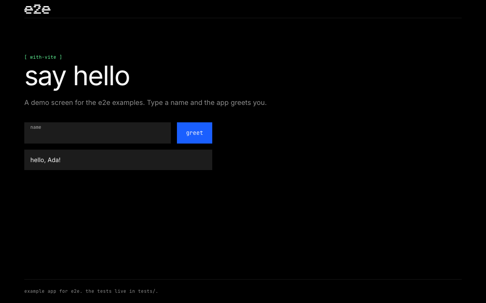

# e2e with Vite

A Vite + React greeting app with three locator tests and two agent tests.



## Run

Use Node 22.22.3+, 24.8+, or 26+. From this folder:

```bash
npm install
npm run test:e2e -- tests/deterministic.e2e.ts --headed
```

The runner starts the app at `http://localhost:5173`.
It downloads Chromium on the first run if needed.

## Agent tests

Create `.env` in this folder (the config loads it explicitly), then fill in
your [DeepSeek API](https://api-docs.deepseek.com/) key:

```dotenv
DEEPSEEK_API_KEY=your-key
DEEPSEEK_BASE_URL=https://api.deepseek.com
DEEPSEEK_MODEL=deepseek-flash
```

`deepseek-flash` supports image input, which the agent may need for screenshots.
The key stays in the ignored `.env` file. Existing shell environment variables
take precedence over values in the file; unset them to use the file's values.

```bash
npm run test:e2e -- tests/agentic.e2e.ts --headed --debug --no-cache
```

Without a valid key, agent tests fail instead of skipping. `--no-cache` uses
fresh model calls. Run `npm run test:e2e` for all five tests.
Results are in `.e2e/report.json`.

See [e2e.config.ts](e2e.config.ts) and [tests/](tests/) for the setup.
For your own app, follow the [Quickstart](https://e2e.com/docs/quickstart).

Last checked: 2026-11-08, build and all three deterministic tests passed with
e2e 0.23.0, @e2e-dev/web 0.15.5, Vite 8.3.6, and Node 24.15.0 for the test run.
DeepSeek agent tests have not been run: the local API key is not configured yet.
